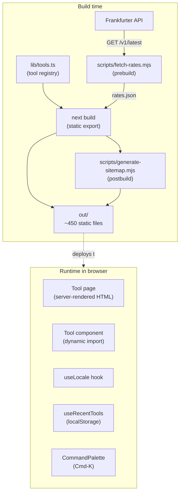

# Architecture

Logical design and code-level decisions for MyDailyTool. For physical infrastructure (AWS, DNS, CDN), see [INFRA.md](INFRA.md).

## What this site is

A static website with **168 interactive client-side tools** (calculators, converters, encoders, etc.). Every tool's logic runs entirely in the user's browser. There is **no backend, no database, no API server**. The build process produces ~450 static files; CloudFront serves them globally.

The static-export model is the single most important architectural choice. It dictates everything downstream:
- No server-side rendering at request time → no per-request latency from the origin
- No backend = no auth, no user accounts, no per-user data
- Every "feature" must work as either build-time data or browser-side JavaScript
- "Deploy" = upload files to S3 + invalidate CloudFront

If a future feature requires server logic (e.g., real-time multi-user editing, or true live currency rates with high accuracy), the architecture would need to fundamentally change. Don't accept that lightly.

## High-level component diagram



## Code layout — what lives where

```
app/                          Next.js App Router pages
├─ layout.tsx                  Root layout: fonts, theme, header/footer, GA4 script
├─ page.tsx                    Home page (hero + featured tools)
├─ [category]/page.tsx         Generates one page per category (/math/, /developer/, ...)
├─ tools/page.tsx              All-tools index
├─ tools/[slug]/page.tsx       Generates one page per tool (uses generateStaticParams)
├─ blog/                       Blog: index + per-post .mdx files
├─ about, contact, privacy, terms, support, sitemap-html
└─ not-found.tsx               404 page

components/
├─ tools/
│  ├─ <ToolName>.tsx           One file per heavy/standalone tool widget (28 files)
│  ├─ <topical>.tsx            Multi-tool files: finance.tsx, marketing.tsx, etc. (12 files)
│  └─ registry.ts              Slug → React component mapping (lazy-loaded)
├─ ToolPage.tsx                Wrapper around every tool widget: breadcrumbs, JSON-LD,
│                              related tools, long-form SEO content
├─ Header.tsx, Footer.tsx      Global chrome
├─ Sidebar.tsx                 Accordion category navigation on tool/category pages
├─ CommandPalette.tsx          Cmd-K search overlay, fuzzy match
├─ LocalePicker.tsx            Header dropdown for locale + currency
├─ RecentTracker.tsx           Logs each tool visit to localStorage
└─ BlogPost.tsx                Wrapper for MDX blog posts

lib/
├─ tools.ts                    Tool + Category registry (single source of truth)
├─ posts.ts                    Blog post registry
├─ locale.ts                   useLocale hook + supported locales
├─ rates.json                  Build-time snapshot of FX rates (rewritten by prebuild)
├─ seo.ts                      Metadata builder + JSON-LD helpers
├─ useRecentTools.ts           localStorage hook for "recently used" tracking
└─ cn.ts                       Tailwind class merger (clsx + twMerge)

scripts/
├─ fetch-rates.mjs             Build-time: GET Frankfurter, write rates.json
├─ generate-sitemap.mjs        Build-time: scan tools.ts + posts.ts, write sitemap.xml
└─ generate-icons.mjs          Manual: convert favicon.svg + og.svg to PNG variants

public/                        Static assets served as-is from /
infra/main.tf                  Terraform for the AWS deploy (alternative to manual CLI)
```

## Key patterns

### 1. Tool registry as the single source of truth

`lib/tools.ts` is the spine of the project. It defines:
- Categories (with slug, name, blurb, icon, ordered list of tools)
- Tools (slug, title, description, keywords, status)

Every other system reads from this registry: navigation, sitemap, search, category pages, breadcrumbs, related-tools sections. **Nothing about a tool is duplicated elsewhere except its React component.**

If you change a tool's title in `tools.ts`, it updates everywhere on the next build. There is no separate "navigation config."

### 2. Static-param generation

`app/tools/[slug]/page.tsx` and `app/[category]/page.tsx` use Next's `generateStaticParams()` to enumerate every URL at build time. Each becomes its own `index.html` file in `out/`. There is no dynamic routing at request time.

When you add a tool to `lib/tools.ts`, the next build emits a new `out/tools/<slug>/index.html`. Sitemap auto-includes it. No other wiring needed.

### 3. Per-tool dynamic imports keep the bundle small

`components/tools/registry.ts` maps each tool slug to a `dynamic(() => import(...))` call. Every tool widget is its own JavaScript chunk. The shared first-load JS for the site is **~88 KB**. Visiting a specific tool only loads that tool's code.

This matters because tool widgets vary wildly in size:
- Percentage Calculator: ~3 KB
- QR Code Generator: ~30 KB (qrcode lib)
- SSL Cert Decoder: ~150 KB (node-forge lib)
- SQL Formatter: ~200 KB (sql-formatter lib)

Putting all of them in the shared bundle would balloon first-load JS to ~1 MB. Lazy loading keeps it at 88 KB.

### 4. ToolPage wrapper standardizes every tool's shell

Every tool component renders its widget inside `<ToolPage tool={tool} content={{...}}>`. The wrapper handles:
- Breadcrumbs
- H1 + description
- 3 JSON-LD schema blocks (WebApplication, BreadcrumbList, FAQPage)
- Long-form SEO content sections (How to use, Formula, Examples, FAQ)
- Related tools internal links (cross-traffic + crawlability)
- AdSense slot placements

Adding a new tool widget is "implement the interactive UI; pass educational content as props."

### 5. Locale formatting (client-side)

`lib/locale.ts` exports a `useLocale()` hook that:
- Auto-detects on first visit from `navigator.language`
- Persists user choice to localStorage
- Exposes formatters: `fmtCurrency`, `fmtNumber`, `fmtDate`, `currencySymbol`
- Broadcasts changes via a CustomEvent so all mounted components update without a page reload

Currency-using tools (Mortgage, Tip, NPV, etc.) destructure `fmtCurrency` and use it for output. Input labels reference `currencySymbol` so a user in IN sees `(₹)` instead of `($)`.

The site is served from one identical static HTML file globally. Locale-specific behavior happens entirely in the browser after hydration.

### 6. Recent-tools tracking via localStorage

`useRecentTools` reads/writes a localStorage key. `RecentTracker` (mounted invisibly inside `ToolPage`) records every tool visit. The home page and command palette read this list to show "recently used."

No backend, no cookie, no tracking on tool inputs — just a slug list in the user's own browser.

### 7. CloudFront Function for directory-style URLs

The site has URLs like `/tools/json-formatter/` (trailing slash). On S3, that path doesn't auto-resolve to `index.html` when accessed via the REST endpoint (which OAC requires). A CloudFront Function (`mydailytool-rewrite`) intercepts requests and rewrites:
- `/foo/` → `/foo/index.html`
- `/foo` (no extension) → `/foo/index.html`

Without this, every tool URL would 404. The function is attached to the distribution as a viewer-request hook.

### 8. SLUG_REDIRECTS for deleted/renamed tools

When a tool is removed (e.g., Character Counter was merged into Word Counter), the old slug is added to `SLUG_REDIRECTS` in `lib/tools.ts`. The `[slug]` page detects it and emits a redirect HTML page (meta-refresh + JS replace) pointing at the canonical replacement.

This preserves SEO juice on old URLs and keeps existing inbound links working.

## Data flow examples

### A user visits the SQL Formatter

1. DNS resolves `mydailytool.com` to a CloudFront edge IP.
2. CloudFront receives `GET /tools/sql-formatter/`.
3. CloudFront Function rewrites to `/tools/sql-formatter/index.html`.
4. CloudFront checks edge cache → cache miss → fetches from S3 via OAC.
5. S3 returns `index.html`. CloudFront caches it (no-cache TTL on HTML, but still cached briefly per visitor).
6. Browser receives HTML with all SEO metadata, JSON-LD, breadcrumbs, related tools, "How to use" content.
7. Browser executes JS: hydrates React, dynamically imports `SqlFormatter.tsx` (~200 KB chunk from `_next/static/`, year-cached).
8. The interactive form is now live. User pastes SQL, types in browser; sql-formatter library formats locally.

The origin S3 bucket sees ~zero requests after the first visitor in any region — CloudFront caches at the edge.

### A user adds a tool (e.g. you, in the future)

1. Edit `lib/tools.ts`: add the tool entry to a category.
2. Create `components/tools/MyNewTool.tsx` (or add to a topical multi-tool file).
3. Register in `components/tools/registry.ts` with a `dynamic()` import.
4. `git push origin main`.
5. GitHub Actions: `npm ci`, `npm run build` (which fetches fresh rates, emits the new tool's `index.html`, regenerates sitemap), `aws s3 sync`, `cloudfront create-invalidation`.
6. ~2 minutes later, the new tool is live globally with full SEO content, structured data, internal links from related tools, and an entry in `sitemap.xml` Google will discover.

## Constraints worth knowing

- **No URL state.** Tools don't read URL query params. If you wanted shareable presets ("here's a Black-Scholes calc with my numbers"), that's net-new feature work.
- **No localization beyond formatting.** The UI is English-only. We localize numbers, dates, currency — not labels or content.
- **Currency rates are daily-fresh, not real-time.** A user-clickable refresh button on the Currency Converter calls Frankfurter live, but other currency-aware tools use the build-time snapshot.
- **No pagination.** All-tools index page renders 168 tools in one HTML doc. That's fine at this scale; if it grows past ~500, paginate.
- **No user accounts, no saved state across devices.** Recent tools and locale choice live in localStorage, scoped to one device + one browser.

## Where the architecture is weak

Documenting honestly:

1. **No tests.** Zero unit tests, zero integration tests, zero e2e. Every change is yolo'd to production. This works at solo-developer scale; it won't if a team grows.
2. **Tool widget files vary in style.** Some are one-tool-per-file (`PercentageCalculator.tsx`); some are multi-tool topical files (`finance.tsx` has 7 components). Inconsistency is technical debt; consolidating would be a multi-hour refactor.
3. **No error boundaries.** A bug in one tool component would crash the whole React tree. In practice this never happens because tools are simple, but it's a latent risk.
4. **No CSP header.** Could be added at CloudFront response level. Worth doing if AdSense is added (XSS surface increases).
5. **No cookie consent banner.** Required by GDPR if AdSense personalized ads target EU/UK. AdSense's own consent module (Funding Choices) handles this if/when AdSense is approved.
6. **`infra/main.tf` is unused.** The actual deploy was done via raw `aws` CLI commands following `DEPLOY.md`. The Terraform file is correct but stale; if the infra changes, only the live AWS resources are updated, not the Terraform.
