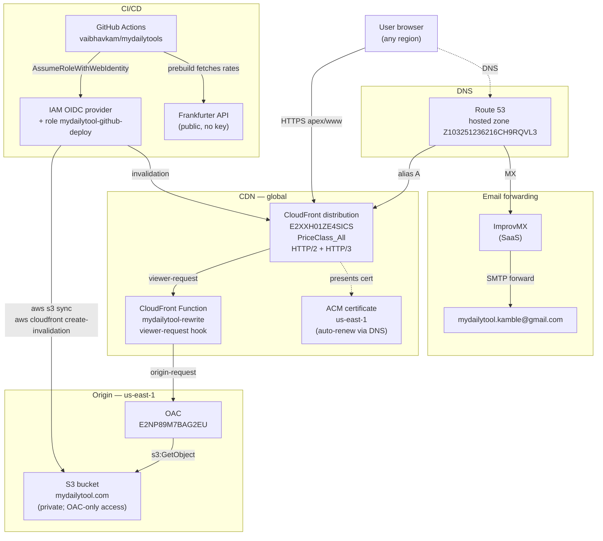

# Infrastructure

Physical deployment of MyDailyTools on AWS. Read [ARCHITECTURE.md](ARCHITECTURE.md) first for the logical design.

## Topology



## Resource inventory

| Resource | ID / value | Region | Notes |
| --- | --- | --- | --- |
| Domain registrar | AWS Route 53 Domains | global | Renews ~$13/yr (April 19) |
| DNS hosted zone | `Z103251236216CH9RQVL3` | global | Free Route 53 zone — actually $0.50/mo |
| ACM certificate | `arn:aws:acm:us-east-1:314138869784:certificate/3fe25fd4-afe4-48d8-83b6-ad7bf9c56b24` | us-east-1 | DNS validation, auto-renew. **Must be in us-east-1** for CloudFront. |
| S3 bucket | `mydailytool.com` | us-east-1 | Private. Public-access blocked. |
| OAC | `E2NP89M7BAG2EU` | global | Origin Access Control linking CloudFront → S3 |
| CloudFront distribution | `E2XXH01ZE4SICS` | global | Domain: `d3l6mdjszodgcz.cloudfront.net` |
| CloudFront Function | `mydailytool-rewrite` | global | Rewrites directory paths to `index.html` |
| IAM OIDC provider | `arn:aws:iam::314138869784:oidc-provider/token.actions.githubusercontent.com` | global | For GitHub Actions; one-per-account |
| IAM role | `mydailytool-github-deploy` | global | Trust scoped to `vaibhavkam/mydailytools:ref:refs/heads/main` |
| AWS account | `314138869784` | — | Personal, dedicated IAM user `mydailytool-deployer` |

## DNS records (Route 53)

```
TYPE   NAME                                  VALUE
A      mydailytool.com.                      ALIAS → d3l6mdjszodgcz.cloudfront.net (Z2FDTNDATAQYW2)
A      www.mydailytool.com.                  ALIAS → d3l6mdjszodgcz.cloudfront.net
MX     mydailytool.com.                      10 mx1.improvmx.com.
                                             20 mx2.improvmx.com.
TXT    mydailytool.com.                      "google-site-verification=sBwN8DdWGO0SAVeJQOL_cJ7QF5kcherDw3X7pxoGuyQ"
                                             "v=spf1 include:spf.improvmx.com ~all"
TXT    _eb1bedefe...mydailytool.com.         ACM validation CNAME (apex cert)
TXT    _5e6cbef0...www.mydailytool.com.      ACM validation CNAME (www cert)
NS     mydailytool.com.                      AWS-assigned nameservers
SOA    mydailytool.com.                      (default)
```

The two ACM validation records must stay in place permanently for cert auto-renewal.

## CloudFront cache behaviors

| Path pattern | Cache policy | Why |
| --- | --- | --- |
| `*.html` | `CachingDisabled` | HTML must reflect deploys instantly |
| `/` | `CachingDisabled` | Same; the homepage is HTML |
| `*` (default) | `CachingOptimized` | All other assets (JS, CSS, fonts, images) — content-hashed filenames are safe to cache for a year |

Both behaviors:
- Compress: enabled (Brotli + gzip)
- Viewer protocol policy: redirect HTTP → HTTPS
- HTTP versions: HTTP/2 + HTTP/3
- Allowed methods: GET, HEAD only

Custom error pages: 403 and 404 → `/404.html` (HTTP 404).

## Deploy pipeline

### On every push to `main`

`.github/workflows/deploy.yml` runs the **build-and-deploy** job:

1. `actions/checkout@v4`
2. `actions/setup-node@v4` with Node 20, npm cache enabled
3. `npm ci --no-audit --no-fund` — installs from public registry (lockfile pins it via project `.npmrc`)
4. `npm run build`
   - **prebuild**: `node scripts/fetch-rates.mjs` → fetches Frankfurter rates → writes `lib/rates.json`
   - `next build` → produces `out/`
   - **postbuild**: `node scripts/generate-sitemap.mjs` → writes `out/sitemap.xml`
5. `aws-actions/configure-aws-credentials@v4` — assumes `mydailytool-github-deploy` IAM role via OIDC (no long-lived AWS keys stored)
6. `aws s3 sync out/ s3://mydailytool.com/` (HTML files, no-cache)
7. `aws s3 sync out/_next/static/ s3://mydailytool.com/_next/static/` (immutable, year-cached)
8. `aws cloudfront create-invalidation` for `/`, `*.html`, `sitemap.xml`, `robots.txt`

Total time: ~90 seconds when warm cache; ~3 min on cold cache.

### Daily cron

The same workflow also runs at **02:30 UTC daily** (`schedule: cron: "30 2 * * *"`). Every run picks up the latest Frankfurter rates and redeploys, so the static site stays daily-fresh on currency without manual intervention.

### IAM trust policy

The OIDC role can be assumed only by GitHub Actions running on `refs/heads/main` of `vaibhavkam/mydailytools`. Pull requests, other branches, other repos cannot assume it. See `iam/trust-policy.json` (we keep a copy in `/tmp` only; the live policy is in AWS).

### IAM permissions

The role's inline policy allows only:
- `s3:PutObject`, `s3:DeleteObject`, `s3:ListBucket`, `s3:GetObject` on `arn:aws:s3:::mydailytool.com/*`
- `cloudfront:CreateInvalidation`, `cloudfront:GetDistribution`, `cloudfront:GetInvalidation` on `arn:aws:cloudfront::314138869784:distribution/E2XXH01ZE4SICS`

Nothing else. A leaked workflow context can only mess with our one bucket and one distribution.

## Required GitHub repo secrets

| Secret | Value | Used by |
| --- | --- | --- |
| `AWS_ROLE_ARN` | `arn:aws:iam::314138869784:role/mydailytool-github-deploy` | OIDC role assumption |
| `S3_BUCKET` | `mydailytool.com` | `aws s3 sync` target |
| `CF_DISTRIBUTION_ID` | `E2XXH01ZE4SICS` | `aws cloudfront create-invalidation` |
| `NEXT_PUBLIC_GA4_ID` | `G-4MB75MYFSR` | Baked into HTML at build time |
| `NEXT_PUBLIC_WEB3FORMS_KEY` | `2062b21d-b510-4db5-b1f9-8b769e0094f8` | Contact form |
| `NEXT_PUBLIC_ADSENSE_*` | (not yet set) | AdSense slots, will be added post-approval |

## Email

Email forwarding is handled by **ImprovMX** (free SaaS, separate from AWS):

```
*@mydailytool.com → mydailytool.kamble@gmail.com
```

ImprovMX does the SMTP receiving and forwards to Gmail. Wired via the MX + SPF records in Route 53.

ImprovMX free tier limit: 25 aliases, 200 messages/day. The catch-all (`*@`) counts as one alias.

## External dependencies

| Service | Purpose | What happens if it's down |
| --- | --- | --- |
| Frankfurter API | Daily FX rate refresh | Falls back to last-known static rates baked into `lib/rates.json` |
| Web3Forms | Contact form submissions | Form button shows error; users can email `hello@mydailytool.com` instead |
| ImprovMX | Email forwarding | Inbound mail bounces; site is unaffected |
| Google Analytics 4 | Visitor analytics | No impact on site, just no data collected for that period |
| AdSense (future) | Ad revenue | No impact; ad slots fall back to placeholder rectangles |
| BMC | Donations | Support page link 404s on BMC's side; site unaffected |

The site itself depends only on AWS (S3 + CloudFront + Route 53 + ACM) for serving. Everything else is value-add.

## Cost estimate

| Service | Monthly cost at low traffic (~10k pageviews) | At 1M pageviews |
| --- | --- | --- |
| S3 storage (~30 MB) | <$0.01 | <$0.01 |
| S3 GET requests | <$0.01 | $0.40 |
| CloudFront egress | $0.08 | $8 |
| CloudFront requests | $0.03 | $3 |
| Route 53 hosted zone | $0.50 | $0.50 |
| Route 53 queries | <$0.01 | $0.40 |
| ACM cert | $0 | $0 |
| **Monthly total** | **~$0.65** | **~$12** |

Domain registration: ~$13/year (paid annually, not in monthly bill).

GitHub Actions: free (2,000 min/mo for private repos; daily cron uses ~30, push deploys use ~3 each).

ImprovMX: free.

## Monitoring

Currently minimal. What's in place:
- **GitHub Actions email** on workflow failure (default behavior; alerts the repo owner)
- **CloudFront standard logs** are not enabled (they're paid + you'd need Athena to query them)

**Not in place** (would be sensible to add):
- CloudWatch billing alarm at $10 threshold (one-time setup; warns of runaway cost)
- Real User Monitoring (we'd lean on GA4 Core Web Vitals once it's collecting data)
- Synthetic uptime check (free tier of UptimeRobot or similar)

See [RUNBOOK.md](RUNBOOK.md) for what to check when something feels wrong.

## Disaster recovery

What happens if a piece of this stack disappears overnight:

| Loss | Recovery time | What you'd do |
| --- | --- | --- |
| S3 bucket deleted | ~5 min | Re-create bucket with same name; trigger workflow rerun → redeploys all files |
| CloudFront distribution deleted | ~30 min | Run the deploy walkthrough in [DEPLOY.md](../DEPLOY.md) from "Step 5" onward |
| Route 53 hosted zone deleted | ~1 hr | Re-create zone (gets new nameservers); update at registrar; re-add all records from this doc |
| GitHub repo lost | ~immediate from local clone | Push existing local clone to a new remote |
| Domain expires | depends on grace period | Renew via Route 53 Domains; nothing else changes |
| Local machine lost | ~5 min | `git clone`, `npm install`, `npm run dev` |

The site is fully reproducible from the git repo + a Route 53 hosted zone. Backups: not strictly necessary because S3 only contains build outputs (recoverable) and Route 53 records are documented above.

## Future considerations

- **Multi-region S3** if traffic skews heavily Asia/AUS. The current setup uses `PriceClass_All` so edges are global, but the *origin* is us-east-1. Cold-cache fetches from Sydney/Mumbai have a ~150ms penalty. Negligible at current traffic.
- **Edge functions** for personalization (e.g., locale-aware first paint). Out of scope until traffic justifies it.
- **WAF** if we ever take user input that hits a backend. We don't, currently.
- **Migration to Cloudflare** if AWS costs exceed Cloudflare's free tier benefits. Possible but not currently warranted.
